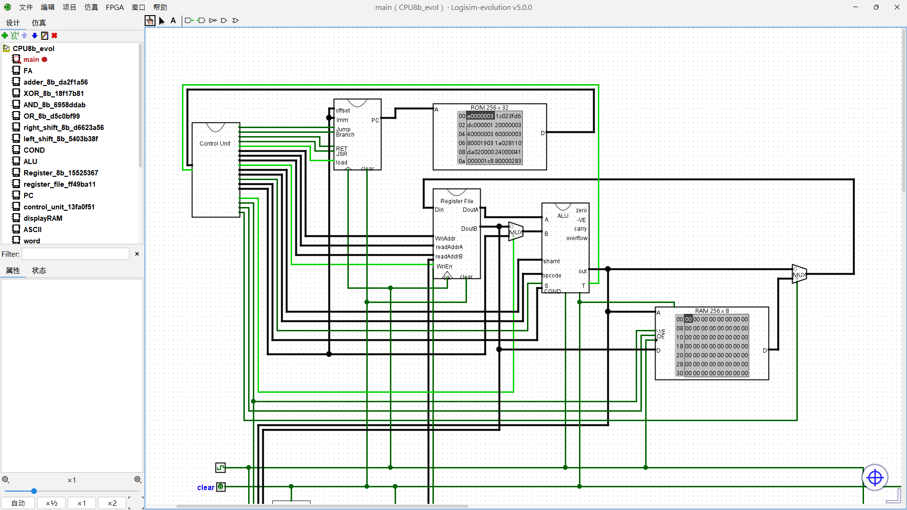

# A-8-bit-Harvard-Architecture-MCU-build-on-logisim-evolution-v5.0.0
This is a Turing-complete microprocessor based on the Harvard architecture, built using Logisim Evolution v5.0.0.  
It includes an ALU capable of processing 8-bit data, a register file, a program counter (PC), a ROM for storing instructions, a RAM and control unit.

The author of logisim-evolution is **Dr. Theo Kluter** (GitHub: [BFH-ktt1](https://github.com/BFH-ktt1))  
I made this MPU using this platform and the MPU project is for personal learning purposes only.  
# How to use the above file  
First, [download Logisim Evolution v5.0.0.](https://github.com/logisim-evolution/logisim-evolution/releases/tag/v5.0.0)  
Second, open the CPU8b.circ file within the software.  
Then, select any MachineCode.hex file from the Program Example and load it into the ROM.  
Finally, press Ctrl+K to run the program.  
**Alternatively, you can write your own program using the assembler.html file provided above. Open the file in any browser.**

# Things you need to know
### Register-File:  
8 1byte Register r0-r7  
r0: constant 0, read only  
r7: connect to keyBoard.  

**Additional features of R7:**  
When Keyboard enter==1 WriEn==1 Register WriAddr==7, r7 data = keyBoard data   
i.e li r7, 0 = listen keyBoard, after you click enter, keyBoard data load into r7  

**example:**  
situation A: **PC==1**, click enter  
0 main:  
1 li r7, 0  
2 beq r0, r7, main  
3 mv r1, r7  
**result** of r1 = keyBoard value  

situation B: **PC!=1**, click enter  
0 main:  
1 li r7, 0  
2 beq r0, r7, main  
3 mv r1, r7  
**result** = looping main until you clik the enter at the moment of PC==1  
___
### RAM:  
address 255 of RAM = the data you want to print to screen  
Using ASCII table, e.g. data == 65, screen = A.  
However, data 0-9 still print 0-9  
e.g. data == 3 or data == 51, both print 3 to screen. different from reality, but writing programs easier.  

**example:**  
li r1, 3  
sw r1, 255(r0)  
li r1, 65  
sw r1, 255(r0)  
**result** = screen shows 3A  
  
___
**Author**:WU Man Wa,Jack  
**IG**: [manwa030](https://www.instagram.com/manwa030?srtk=MXM2dTJrd2llbWhzNA==)  
**Website**: [manwa.xo.je](https://manwa.xo.je/)  
**Last update**: 2026/11/13  

